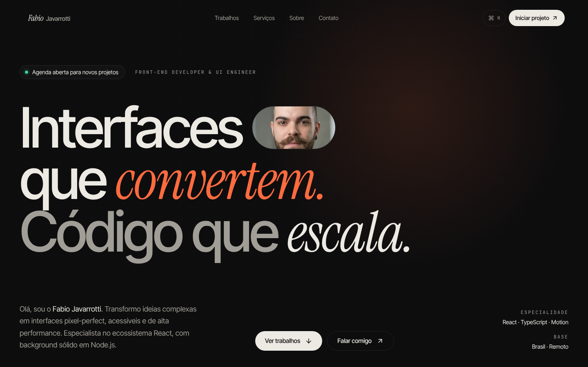

# 🚀 Portfólio Profissional (2025 Edition)

> Um portfólio moderno, responsivo e de alta performance desenvolvido para demonstrar expertise em Front-end Engineering e UI/UX.

 
https://meu-portfolio-henna.vercel.app/

## ✨ Funcionalidades

- **💎 Identidade editorial:** tinta quente, marfim e um único acento laranja; tipografia *Instrument Serif* + *Inter Tight* + *JetBrains Mono*.
- **🎬 Motion premium:** revelações de texto linha a linha, imagens com `clip-path` ao rolar, parallax sutil, botões magnéticos com mola e cursor "Ver ao vivo" nos projetos — tudo respeitando `prefers-reduced-motion`.
- **🎯 Foco comercial:** fluxo Hero → Trabalhos → Serviços → Sobre → Contato, com CTAs recorrentes e e-mail com cópia em um clique.
- **⌨️ Command Menu (Ctrl/⌘ + K):** busca com filtro, navegação por setas e Enter, padrão combobox/listbox acessível.
- **📱 Do mobile ao ultrawide:** gutter fluido, tipografia com `clamp()` e largura máxima controlada.
- **♿ Acessibilidade:** skip link, landmarks, foco visível, contraste AA/AAA e menu móvel com Escape.
- **🧪 Testes E2E:** Playwright em desktop e mobile, com `data-testid` e seletores por papel (role).

## 🛠️ Stack Tecnológica

Este projeto utiliza as ferramentas mais atuais do mercado (Standard 2025):

- **Core:** [React 19](https://react.dev/) + [Vite](https://vitejs.dev/)
- **Linguagem:** [TypeScript](https://www.typescriptlang.org/)
- **Estilização:** [Tailwind CSS v3](https://tailwindcss.com/)
- **Ícones:** [Lucide React](https://lucide.dev/)
- **Animações:** [Framer Motion](https://www.framer.com/motion/)
- **Utils:** `clsx` e `tailwind-merge` para classes condicionais.

## 🚀 Como rodar localmente

Siga os passos abaixo para clonar e executar o projeto na sua máquina:

### Pré-requisitos
- Node.js (versão 18 ou superior) instalado.

### Passo a passo

1. **Clone o repositório**
   ```bash
   git clone [https://github.com/Fabferna/meu-portfolio.git](https://github.com/Fabferna/meu-portfolio.git)
   cd meu-portfolio
Instale as dependências

Bash

npm install
Inicie o servidor de desenvolvimento

Bash

npm run dev
Acesse no navegador O projeto estará rodando em http://localhost:5173

📦 Como fazer Deploy
Este projeto é otimizado para deploy na Vercel ou GitHub Pages.

Vercel (Recomendado)
Crie uma conta na Vercel.

Importe este repositório do GitHub.

A Vercel detectará o Vite automaticamente. Clique em Deploy.

🧪 Testes end-to-end

```bash
npm run test:e2e   # build + preview + Playwright (desktop e mobile)
```

📂 Estrutura de Pastas

```
src/
├── components/
│   ├── features/    # CommandMenu, ProjectCase
│   ├── layout/      # Header, Footer
│   ├── sections/    # Hero, Marquee, Work, Services, About, Contact
│   └── ui/          # Reveal, ButtonLink, SectionHeader
├── data/            # Conteúdo (textos, links, projetos, serviços)
├── hooks/           # useActiveSection
├── lib/             # utils + curvas de easing
└── App.tsx
tests/e2e/           # Specs do Playwright
```

📄 Licença
Este projeto está sob a licença MIT. Sinta-se à vontade para usar como inspiração.

<div align="center"> Desenvolvido com 💜 por <a href="https://www.linkedin.com/in/fabio-javarrotti-372172120/" target="_blank">Fabio Javarrotti</a> </div>


### Dica Extra (Opcional):

No README eu coloquei uma referência a uma imagem `preview-cover.png`. Se você quiser deixar seu GitHub **muito bonito**, tire um print da tela inicial do seu site funcionando, salve com esse nome dentro de `public/assets/` e suba para o GitHub. Assim, quem entrar no seu repositório já vê a cara do site de primeira\!
